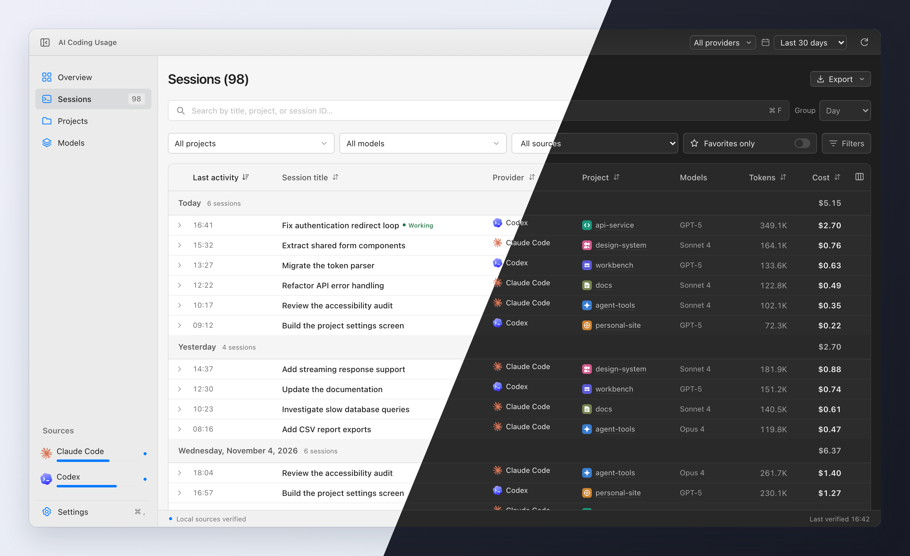
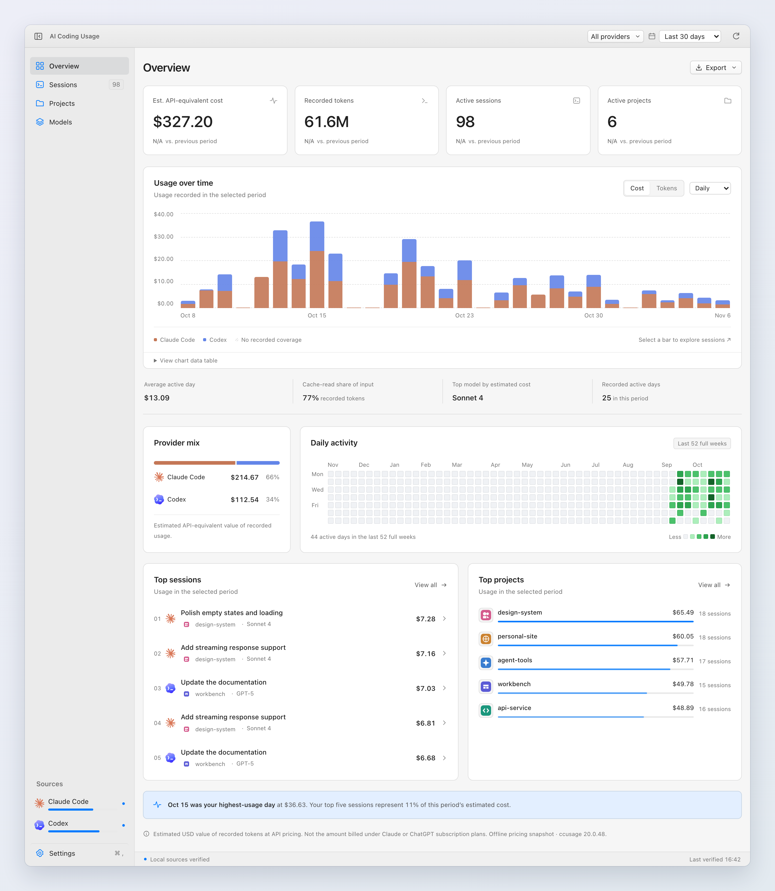
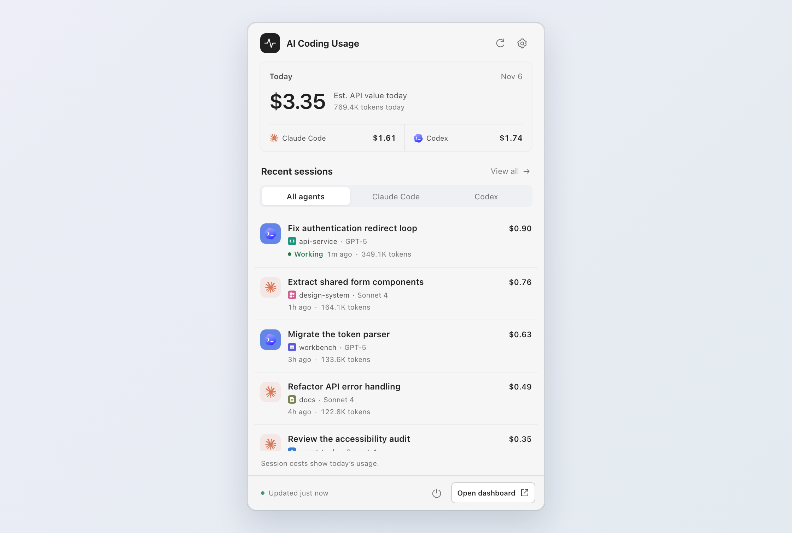

# AI Coding Usage

A desktop dashboard for Claude Code and OpenAI Codex. See your sessions, token usage and estimated costs in one place, with a quick view in your menu bar or system tray.

[Website](https://huseyint.com/agent-usage/) · [Downloads](https://github.com/huseyint/agent-usage/releases)



## Features

- **Sessions** — Search, filter and group conversations by date, project or provider. See which sessions are working, add local titles and tags, and favorite useful conversations.
- **Overview** — Explore daily, weekly and monthly usage, provider totals, top projects and model breakdowns.
- **Menu bar & system tray** — Check today’s usage and recent sessions without opening the dashboard.
- **Monthly allowances** — Set a budget for each provider and follow estimated spend in the sidebar.
- **Local and private** — Reads your existing logs without changing them. No account, API keys, telemetry or uploads.
- **Make it yours** — Light and dark themes, project icons, custom source folders, and CSV or JSON exports.

Costs are estimated USD API-equivalent token values, not subscription bills or provider quota usage.

## Install

Download installers from [Releases](https://github.com/huseyint/agent-usage/releases):

| Platform | Download |
| --- | --- |
| macOS · Apple Silicon | `.dmg` |
| Windows · x64 | `.exe` |
| Linux · x64 | `.AppImage`, `.deb` or `.rpm` |

Signing, notarization and clean-machine validation are still pending. See the [release guide](docs/RELEASING.md) for build and signing details.

### macOS first launch

The macOS build is not notarized. Download it from this repository's [Releases](https://github.com/huseyint/agent-usage/releases), then copy **AI Coding Usage.app** to **Applications**. If macOS blocks the app because the developer cannot be verified, use either method below.

**System Settings**

1. Try opening **AI Coding Usage** in Applications, then dismiss the warning.
2. Go to **Apple menu → System Settings → Privacy & Security** and scroll to **Security**.
3. Find the message about AI Coding Usage and click **Open Anyway**. Authenticate if prompted, then click **Open** in the confirmation dialog.

If **Open Anyway** is missing, try opening the app again and return to this settings page. See [Apple's instructions](https://support.apple.com/en-us/102445).

**Terminal**

Open Terminal and run:

```sh
xattr -dr com.apple.quarantine "/Applications/AI Coding Usage.app"
open "/Applications/AI Coding Usage.app"
```

This removes the download quarantine attribute from this app bundle. Replace the path if you installed the app elsewhere.

### Windows installer warning

The Windows installer is unsigned, so Microsoft Defender SmartScreen may show **Windows protected your PC** or an unrecognized-app warning. Download the installer from this repository's [Releases](https://github.com/huseyint/agent-usage/releases).

**SmartScreen dialog**

1. Open the downloaded `AI-Coding-Usage_1.0.0_windows-x64-setup.exe`.
2. On the SmartScreen warning, click **More info**, then **Run anyway**.
3. Complete the installer, then open **AI Coding Usage** from the Start menu.

**PowerShell**

To remove the download block from this installer file before opening it, run:

```powershell
$installer = Join-Path $HOME "Downloads\AI-Coding-Usage_1.0.0_windows-x64-setup.exe"
Unblock-File -LiteralPath $installer
Start-Process -FilePath $installer
```

Adjust the filename and location for your download. `Unblock-File` removes this file's downloaded-from-the-internet marker; it does not sign the installer. If **Run anyway** is unavailable, Smart App Control or an organization policy may block unsigned apps. On a managed PC, contact your administrator.

See Microsoft's [SmartScreen guidance](https://learn.microsoft.com/en-us/windows/apps/package-and-deploy/smartscreen-reputation) and [Unblock-File documentation](https://learn.microsoft.com/en-us/powershell/module/microsoft.powershell.utility/unblock-file).

## Use

1. Open the app and connect Claude Code, Codex, or both. Standard local folders are detected automatically; add custom folders in **Settings → Sources**.
2. Refresh to load your usage, then choose a provider and date range.
3. Browse **Sessions** for individual conversations, **Overview** for trends, or **Projects** and **Models** for breakdowns. Click a session for details.
4. Set monthly allowances in **Settings → Engine & costs** to show progress in the sidebar. Click the menu bar or tray icon for a quick check.

Reports show costs within the selected dates. Session details also include lifetime cost. **Working** is a best-effort signal from recent log activity.

### Overview



### Menu bar



## Development

Requires Node 26.13+ LTS (the exact development and CI version is in `.node-version`), pnpm, stable Rust and the [Tauri prerequisites](https://v2.tauri.app/start/prerequisites/).

```sh
pnpm install --frozen-lockfile
pnpm engine:build
pnpm desktop
```

For a browser preview with mock data, run `pnpm dev`. Run `pnpm test` and `pnpm check` before contributing.

See [Contributing](CONTRIBUTING.md), the [detailed reference](docs/REFERENCE.md), [architecture](docs/adr/001-engine-and-cache.md), and [release validation](docs/VALIDATION.md).

## License

[MIT](LICENSE). Built with [ccusage](https://github.com/ccusage/ccusage); see [third-party notices](THIRD_PARTY_NOTICES.md). Independent of OpenAI and Anthropic.
